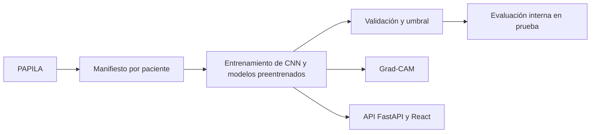

# GlaucoAI: clasificación de glaucoma en imágenes de fondo de ojo con aprendizaje profundo

> **Alcance.** Trabajo académico. Los modelos entregan puntajes experimentales sin calibrar y no son un instrumento de diagnóstico clínico.

---

## 1. Resumen

El proyecto clasifica imágenes de fondo de ojo del dataset PAPILA (420 imágenes de 210 pacientes) en **sano** o **glaucoma**. Se desarrollaron una **CNN pequeña entrenada desde cero** y modelos con **transfer learning** desde ImageNet (ResNet18, ResNet34 y EfficientNet-B0). La demostración web sirve una **ResNet34**.

El trabajo tuvo tres etapas: (1) un notebook con experimentos sistemáticos de regularización y optimización sobre la CNN; (2) un pipeline reproducible con partición por paciente, verificación criptográfica, evaluación interna congelada, intervalos *bootstrap* por paciente, Grad-CAM y demo web; (3) tres campañas de optimización para mejorar la sensibilidad.

Resultados principales: **(i)** el aumento de datos fue la única técnica que mejoró la CNN; **(ii)** el transfer learning separa mejor las clases (ROC-AUC 0,795 con ResNet18 frente a 0,716 con la CNN en test); **(iii)** la ResNet34 adoptada detecta 13 de 17 glaucomas en test (sensibilidad 76,5 %, especificidad 92,5 %, ROC-AUC 0,873), pero **se eligió tras ver los resultados de test**, no alcanza la meta de 85 % y su intervalo de confianza va de 50 % a 100 %. Las cifras son exploratorias y requieren una cohorte independiente.

## 2. Introducción y objetivos

El glaucoma daña el nervio óptico y puede causar pérdida de visión irreversible; su evaluación incluye el examen del disco óptico, visible en el fondo de ojo.

**Objetivo general:** construir y evaluar con rigor clasificadores de glaucoma basados en redes convolucionales.

**Específicos:** (1) preparar PAPILA sin fuga de información; (2) estudiar regularización y optimización en una CNN de referencia; (3) aplicar transfer learning y compararlo con la CNN; (4) evaluar con un protocolo reproducible que separe selección (validación) y estimación (test), cuantificando la incertidumbre; (5) explicar las predicciones con Grad-CAM y ofrecer una demo web.

## 3. Marco conceptual

- **CNN:** aprenden filtros que detectan patrones locales y los combinan en capas sucesivas (Aggarwal, 2018).
- **Transfer learning:** reutiliza una red entrenada en un problema grande (ImageNet; Deng et al., 2009). Con 274 imágenes de entrenamiento, entrenar millones de parámetros desde cero sobreajusta; por eso se reutiliza una ResNet (He et al., 2016) y se ajusta solo la cabeza o los últimos bloques.
- **Sobreajuste y regularización:** L2, *dropout*, aumento de datos y parada temprana.
- **Métricas con clases desbalanceadas:** con 79 % de ojos sanos, la exactitud engaña. Se reportan **sensibilidad**, **especificidad**, precisión, F1, **ROC-AUC** y AP; se prioriza la sensibilidad (un glaucoma sin detectar es más costoso que una falsa alarma).
- **Grad-CAM:** usa los gradientes de la salida respecto a las activaciones de una capa convolucional para resaltar regiones influyentes (Selvaraju et al., 2017).

## 4. Datos

**PAPILA** (Kovalyk et al., 2022): fondo de ojo de ambos ojos de 244 pacientes, con datos clínicos. Se usó la copia `valentinaache/glaucomaPGUSab` (commit `41f0a07…`).

| Característica | Valor |
|---|---|
| Imágenes originales / sospechosas excluidas | 488 / 68 |
| Imágenes utilizadas | **420** (210 pacientes, ambos ojos) |
| Distribución | 333 sanas (79 %) y 87 con glaucoma (21 %) |

**Partición sin fuga:** los dos ojos de un paciente están correlacionados, así que cada paciente va a un solo conjunto. Se agrupan por perfil de diagnósticos y se reparten 65/15/20 con semilla 42; el manifiesto CSV queda fijado con su SHA-256.

| Conjunto | Pacientes | Imágenes | Sanos | Glaucoma |
|---|---:|---:|---:|---:|
| Entrenamiento | 137 | 274 | 217 | 57 |
| Validación | 31 | 62 | 49 | 13 |
| Prueba | 42 | 84 | 67 | 17 |

> El notebook usó otra partición (272/64/84): sus métricas no son comparables con las del pipeline.

## 5. Metodología

**Preprocesamiento.** CNN: 96 × 96 px, normalización con estadísticas de entrenamiento. Modelos preentrenados: 224 × 224 px con *letterbox* (conserva la proporción, relleno negro) y normalización de ImageNet. Solo se aplica volteo horizontal, y únicamente en entrenamiento.

**Modelos.** CNN de dos bloques convolucionales y capa densa de 128 (~4,74 M de parámetros). ResNet18 con *backbone* congelado y capa `Linear(512, 1)` (513 parámetros; respaldo). **ResNet34** con ajuste de la cabeza y `layer4` (13,1 M de 21,3 M de parámetros), BatchNorm activa en ese bloque. EfficientNet-B0 solo en campañas.

**Entrenamiento.** PyTorch (Paszke et al., 2019), `BCEWithLogitsLoss`, Adam (Kingma y Ba, 2015), lote 16, semilla 42, parada temprana (paciencia 5) con restauración de la mejor época. La ResNet34 servida usa Adam 0,0001, peso positivo 217/57 ≈ 3,81, semilla 43, época 4 y umbral 0,48704302310943604.

**Notebook (CNN).** Tras diagnosticar sobreajuste, siete barridos (L2, *dropout*, aumento, paciencia, tasa de aprendizaje, optimizador y un factorial de 48 configuraciones), eligiendo siempre por pérdida de validación.

**Campañas de optimización.** El equipo exploró ajuste fino por bloques, BatchNorm, pérdidas (BCE ponderada, focal), optimizadores, tasas y aumentos en 62 entrenamientos con tres semillas por finalista (`configs/papila-final.json`). Detalle en `docs/11-campanas-experimentales.md`.

## 6. Protocolo de evaluación

- **Validación:** compara modelos, elige la época y fija el umbral (rejilla de 0,05 con especificidad ≥ 80 %; en las campañas, puntos medios maximizando el mínimo entre sensibilidad y especificidad).
- **Prueba:** la evaluación congelada original (CNN y ResNet18) registró de antemano hashes SHA-256 del manifiesto, imágenes y checkpoints, umbrales, versiones y equipo, y reservó la carpeta de resultados antes de decodificar la primera imagen. Las campañas posteriores usaron un archivo de bloqueo (`test-lock.json`).
- **Incertidumbre:** *bootstrap* del 95 % remuestreando **pacientes** (ambos ojos juntos), con el mismo remuestreo para comparar modelos.

**Salvedad importante.** El test se consultó en experimentos históricos y en las tres campañas, y el equipo declara que **la ResNet34 se adoptó después de revisar los resultados de test**. Por eso el test no es una estimación independiente: la evaluación es **interna y exploratoria** y las cifras de la ResNet34 son probablemente optimistas.

## 7. Resultados

### 7.1 CNN del notebook

Con pérdida de validación base 0,3487: L2 y *dropout* no mejoraron; el **aumento Leve (solo volteo)** la bajó a 0,2907 y el Fuerte la empeoró (0,4119); paciencia 3 produjo subajuste, 5 y 10 igualaron al base; tasa de aprendizaje y optimizador dieron diferencias despreciables. En el factorial, la mejor configuración fue Adam + aumento y las 10 mejores incluyen aumento.

Modelo final del notebook en test (84 imágenes, umbral 0,5): exactitud 0,857, sensibilidad 0,588, F1 0,625, ROC-AUC 0,817 (10 de 17 glaucomas detectados, 5 falsos positivos).

### 7.2 Pipeline reproducible

| Partición | Modelo | Umbral | Sensibilidad | Especificidad | ROC-AUC |
|---|---|---:|---:|---:|---:|
| Validación (62) | CNN | 0,50 | 38,5 % | 89,8 % | 0,739 |
| Validación (62) | ResNet18 | 0,35 | 69,2 % | 93,9 % | 0,859 |
| Prueba (84) | CNN | 0,50 | 47,1 % (8/17) | 88,1 % | 0,716 |
| Prueba (84) | ResNet18 | 0,35 | 35,3 % (6/17) | 94,0 % | 0,795 |

### 7.3 Campañas y modelo adoptado

| Modelo (prueba) | Umbral | Sensibilidad | Especificidad | ROC-AUC |
|---|---:|---:|---:|---:|
| ResNet18 con `layer4`, BCE | 0,10 | 70,6 % | 74,6 % | 0,834 |
| ResNet18 con `layer4`, BCE ponderada | 0,40 | 58,8 % | 88,1 % | 0,836 |
| EfficientNet-B0 (elegido por validación) | 0,357 | 76,5 % | 67,2 % | 0,824 |
| **ResNet34 (adoptada)** | **0,487** | **76,5 % (13/17)** | **92,5 %** | **0,873** |

En validación la ResNet34 obtuvo 84,6 % de sensibilidad, 93,9 % de especificidad y ROC-AUC 0,898. Con tres semillas, las recetas finalistas quedaron muy parejas y solo una semilla de cada una alcanzó la meta de 85 % en ambas tasas. Intervalos de la ResNet34 en test: sensibilidad 50–100 %, especificidad 86,4–98,4 %.

## 8. Discusión

- **El aumento de datos ayudó y la regularización clásica no.** El volteo conserva la anatomía del disco; un aumento fuerte la distorsiona.
- **La pérdida de validación no garantiza la mejor métrica de test:** con 64 imágenes de validación y 84 de prueba las estimaciones son inestables.
- **El transfer learning mejora la separación de clases** (mayor ROC-AUC) con pocos parámetros entrenados.
- **La sensibilidad de la ResNet18 cayó en test** (69,2 % → 35,3 %): el umbral se eligió en la propia validación, un caso mueve 6–8 puntos y la comparación mezclaba umbrales ajustados y no ajustados.
- **Riesgo de sobreajuste al test con la ResNet34.** Se evaluaron muchos modelos sobre las mismas 84 imágenes y se eligió el mejor viéndolas. Parte de su ventaja puede deberse a esa selección. La conclusión sustentada es que es un **candidato prometedor que requiere confirmación independiente**, no un modelo validado.

## 9. Explicabilidad y demostración web

**Grad-CAM** se calcula sobre la última capa convolucional (`backbone.layer4[-1]`, 7 × 7) respecto al logit de glaucoma y se recorta con la geometría del *letterbox*. Sus mapas **no prueban** que el modelo observe estructuras clínicamente relevantes; permiten formular hipótesis.

**Demo.** FastAPI sirve por defecto la ResNet34 (ResNet18 de respaldo con `GLAUCOAI_MODEL`), valida el hash del checkpoint al iniciar y procesa las imágenes en memoria. La interfaz React muestra modelo, clase, puntaje, umbral y Grad-CAM, e incluye un recorrido didáctico de ocho pasos (los cuatro primeros se calculan en el navegador; los últimos usan la respuesta real). Se ejecuta localmente, en Docker o en Render (API) y Vercel (interfaz). Los tiempos medidos (~280 ms por análisis) corresponden a la ResNet18; no hay prueba de la ResNet34 en los 512 MB de Render gratuito.

## 10. Reproducibilidad

- Semillas y algoritmos deterministas de PyTorch.
- Huellas SHA-256 de manifiesto, imágenes, checkpoints y pesos de ImageNet.
- Configuraciones congeladas en `configs/` (evaluación original, modelos servidos y campaña final).
- Registro por corrida (historial, resumen, checkpoint) y 77 pruebas automáticas (5 requieren GPU).
- La evaluación congelada original solo corre en el equipo de referencia; los resultados de las campañas están en `models/runs/` (no versionado).

## 11. Limitaciones y trabajo futuro

**Limitaciones:** test de 84 imágenes (17 positivas); un solo split; test consultado repetidamente y **modelo servido elegido tras verlo**; sensibilidad de la ResNet34 bajo la meta (76,5 %, intervalo 50–100 %); puntajes sin calibrar; una sola fuente de datos.

**Trabajo futuro:** (1) **confirmar la ResNet34 en una cohorte independiente**, con un test reservado que no se consulte para decidir; (2) validación cruzada agrupada por paciente; (3) calibración de puntajes; (4) comparar Grad-CAM con los contornos de disco y copa de PAPILA.

## 12. Conclusiones

1. Se construyó un pipeline completo, de los datos a una demo web, con control de fuga entre pacientes y verificación criptográfica de datos y modelos.
2. En la CNN, el aumento de datos fue la técnica más útil; L2 y *dropout* no aportaron.
3. El transfer learning mejora la separación de clases; con ajuste fino, la ResNet34 detecta 13 de 17 glaucomas, aunque la cifra es exploratoria y no alcanza la meta de 85 %.
4. El principal aporte es metodológico: preparar y evaluar de forma reproducible un modelo con pocos datos y reconocer sus límites, incluido que el test se consultó repetidamente y que el modelo final requiere confirmación independiente.

## 13. Referencias

Aggarwal, C. C. (2018). *Neural networks and deep learning: A textbook*. Springer. https://doi.org/10.1007/978-3-319-94463-0

Deng, J., et al. (2009). ImageNet: A large-scale hierarchical image database. *CVPR*, 248–255.

He, K., Zhang, X., Ren, S., & Sun, J. (2016). Deep residual learning for image recognition. *CVPR*, 770–778.

Kingma, D. P., & Ba, J. (2015). Adam: A method for stochastic optimization. *ICLR*.

Kovalyk, O., et al. (2022). PAPILA: Dataset with fundus images and clinical data of both eyes of the same patient for glaucoma assessment. *Scientific Data, 9*, 291. https://doi.org/10.1038/s41597-022-01388-1

Paszke, A., et al. (2019). PyTorch: An imperative style, high-performance deep learning library. *NeurIPS, 32*.

Selvaraju, R. R., et al. (2017). Grad-CAM: Visual explanations from deep networks via gradient-based localization. *ICCV*, 618–626.

Más detalle técnico: [índice de la documentación](README.md).

---